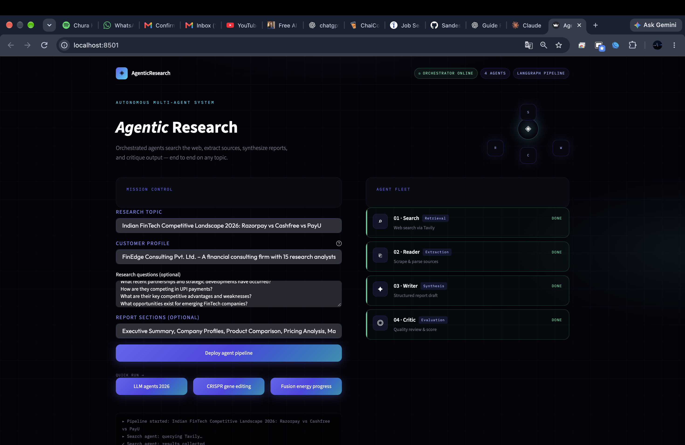
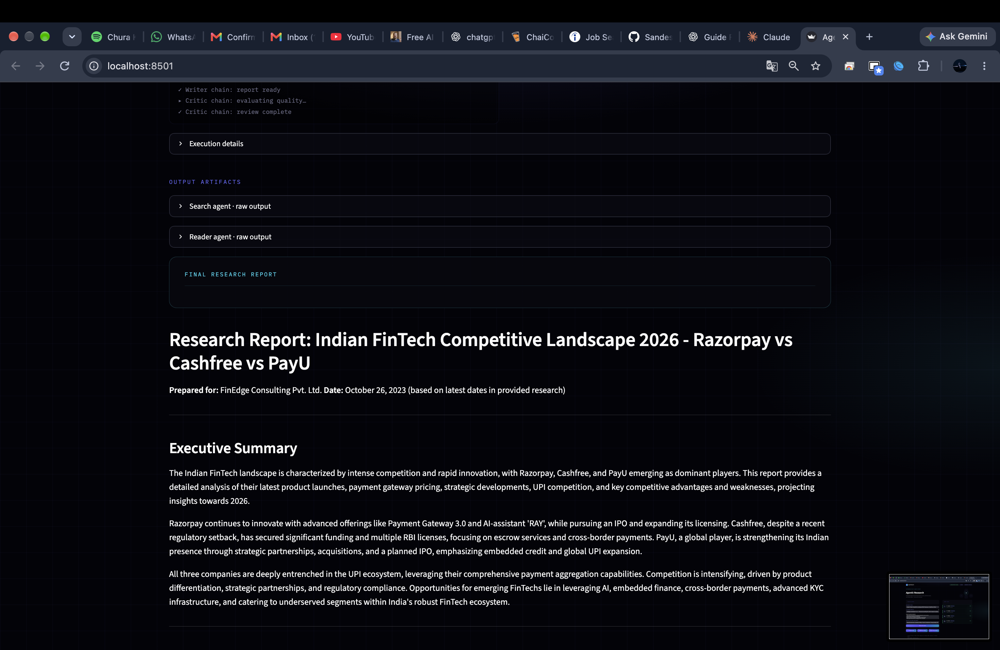
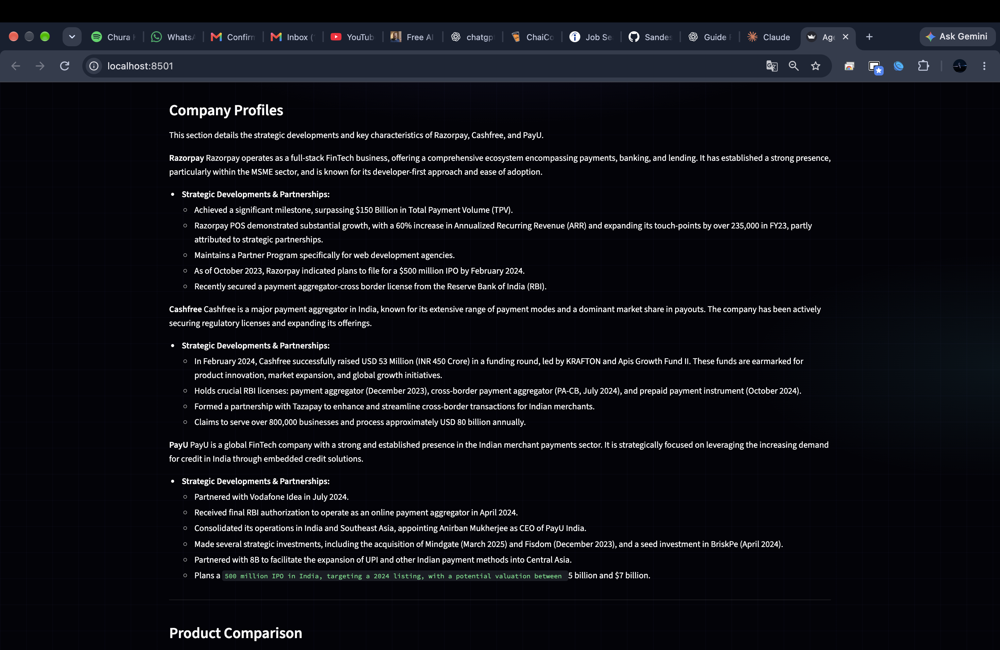
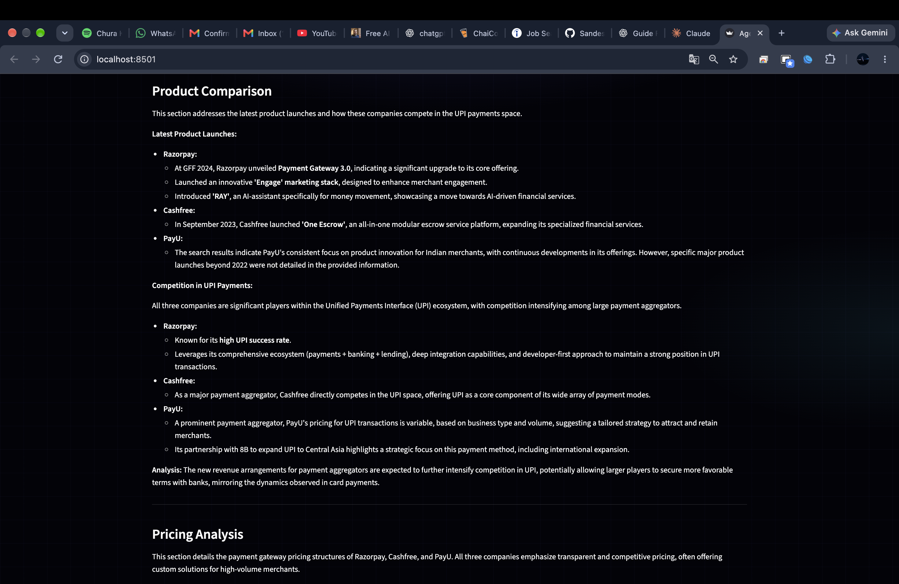
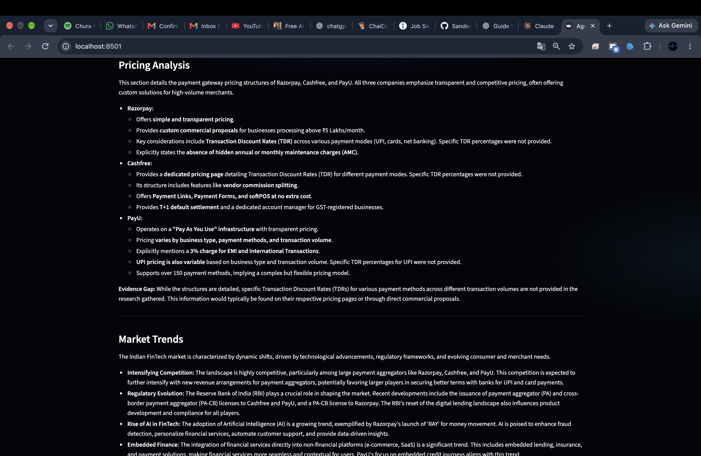
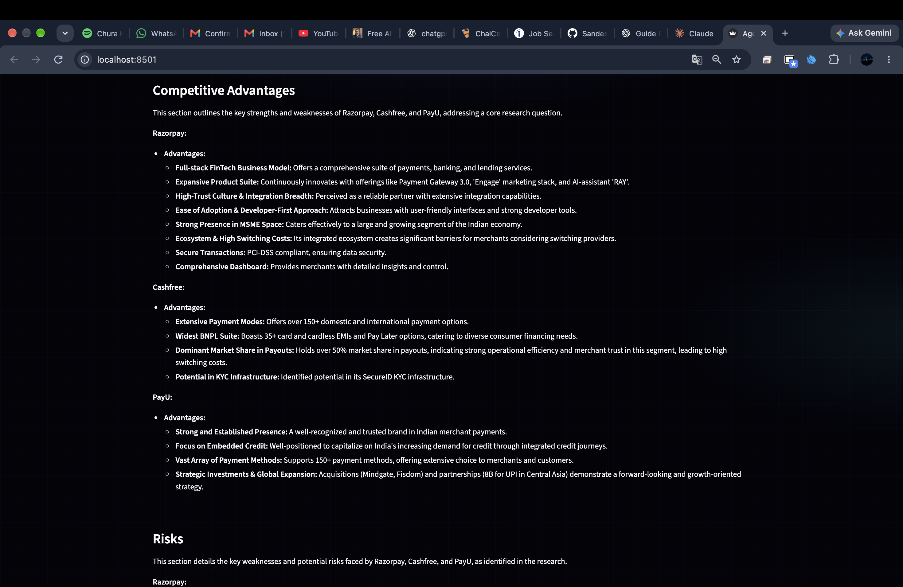
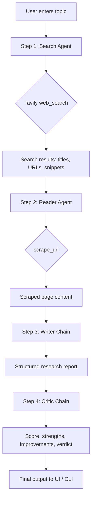

# AgenticResearch

A multi-agent research system that orchestrates four specialized AI components — **Search**, **Reader**, **Writer**, and **Critic** — to produce structured research reports on any topic.

Built with **LangChain**, **Google Gemini**, **Tavily** (web search), and a **Streamlit** agentic UI.

---

## Features

- **Autonomous web search** — Search Agent queries Tavily for recent, reliable sources
- **Deep content extraction** — Reader Agent picks a URL and scrapes full page text
- **Report synthesis** — Writer Chain drafts a structured markdown report
- **Quality review** — Critic Chain scores the report and suggests improvements
- **Live UI** — Streamlit dashboard with real-time agent status and activity log
- **CLI mode** — Run the full pipeline from the terminal via `pipeline.py`
- **Resilient execution** — Bounded exponential retries, upstream timeouts, Tavily rate limiting, structured errors, and per-stage execution records
- **Source checks** — Reject malformed URLs and validate publication dates when page metadata is available; inaccessible pages fall back to search snippets with an explicit disclosure

## Current application screenshots

Screenshots from the current Streamlit application and its generated report, captured November 4, 2026.

<details>
<summary>View the six screenshots</summary>













</details>

---

## Project Structure

```
Multi-agent-research-system/
├── app.py           # Streamlit UI (mission control + agent fleet + results)
├── agents.py        # LLM setup, agent builders, writer & critic chains
├── pipeline.py      # CLI orchestrator — runs all 4 steps sequentially
├── tools.py         # LangChain tools: web_search (Tavily), scrape_url
├── resilience.py    # Retries, rate limits, error records, stage tracking
├── customer_config.py # Validated customer profile loading and resolution
├── schemas.py       # Pydantic research request/response schemas
├── customer_configs/ # JSON profile examples
├── assets/screenshots/ # Current application screenshots
├── requirements.txt # Python dependencies
├── .env             # API keys (not committed — create locally)
└── README.md
```

### Module responsibilities

| File | Role |
|------|------|
| `tools.py` | External integrations — Tavily search API and HTTP page scraping |
| `agents.py` | Shared Gemini LLM; builds Search/Reader agents; defines Writer & Critic prompt chains |
| `pipeline.py` | Core pipeline logic — invokes agents in order and returns a state dict |
| `app.py` | Web UI — stepwise execution with live status updates and downloadable reports |

---

## Architecture

```
┌─────────────────────────────────────────────────────────────────┐
│                         User Input                               │
│                    (research topic)                              │
└────────────────────────────┬────────────────────────────────────┘
                             │
                             ▼
┌─────────────────────────────────────────────────────────────────┐
│  app.py / pipeline.py  —  Orchestrator                           │
└────────────────────────────┬────────────────────────────────────┘
                             │
         ┌───────────────────┼───────────────────┐
         ▼                   ▼                   ▼
┌─────────────────┐ ┌─────────────────┐ ┌─────────────────┐
│  Search Agent   │ │  Reader Agent   │ │ Writer + Critic │
│  (LangChain     │ │  (LangChain     │ │ (prompt chains) │
│   agent + tool) │ │   agent + tool) │ │                 │
└────────┬────────┘ └────────┬────────┘ └────────┬────────┘
         │                   │                   │
         ▼                   ▼                   ▼
┌─────────────────┐ ┌─────────────────┐ ┌─────────────────┐
│  web_search     │ │  scrape_url     │ │  Gemini LLM     │
│  (Tavily API)   │ │  (requests +    │ │  (no tools)     │
│                 │ │   BeautifulSoup)│ │                 │
└─────────────────┘ └─────────────────┘ └─────────────────┘
```

All agents and chains share a single **`ChatGoogleGenerativeAI`** instance configured in `agents.py`.

---

## Pipeline Flow

The pipeline runs **four sequential steps**. Each step passes its output to the next.



### Step-by-step

1. **Search Agent** (`build_search_agent`)
   - Tool: `web_search` → Tavily API (up to 5 results)
   - Prompt: find recent, reliable information on the topic
   - Output: `search_results` / `search`

2. **Reader Agent** (`build_reader_agent`)
   - Tool: `scrape_url` → fetches and parses HTML (max 3000 chars)
   - Prompt: pick the most relevant URL from search results and scrape it
   - Output: `scraped_content` / `reader`

3. **Writer Chain** (`writer_chain`)
   - No tools — pure LLM prompt chain
   - Input: topic + combined search + scraped content
   - Output: markdown report (Introduction, Key Findings, Conclusion, Sources)

4. **Critic Chain** (`critic_chain`)
   - No tools — evaluates the writer output
   - Output: score (/10), strengths, areas to improve, one-line verdict

### Pipeline state

**CLI** (`pipeline.py`) returns:

```python
{
    "search_results": str,
    "scraped_content": str,
    "report": str,
    "feedback": str,
}
```

**UI** (`app.py`) stores the same data under keys: `search`, `reader`, `writer`, `critic`.

---

## Setup

### Customer profiles and request schemas

The pipeline accepts an optional customer ID while preserving the existing default:

```python
from pipeline import run_research_pipeline

result = run_research_pipeline(
    "Grid scale battery storage",
    customer_id="example",
    research_questions=["What changed this year?", "Who benefits and who is exposed?"],
    deliverables=["Executive summary", "Competitor comparison", "Risks", "Sources"],
)
```

Customer profiles are validated against `CustomerConfig` in `customer_config.py`. Each customer gets a JSON file named for its short ID, for example `customer_configs/acme_research.json`; set `CUSTOMER_CONFIG_DIR` to use another directory in a deployment. Profiles can contain organization context (industry, objective, current problem, expected output), model and writing policy, retry and timeout limits, search pacing, source count, and an approval policy flag. The same profile model applies to any customer; `customer_configs/example.json` is only a template. Do not put API keys or other secrets in customer profiles. `schemas.py` defines validated request, source, execution, and response contracts for the API layer.

The Streamlit form takes a research topic, either a saved customer profile ID or a free-form customer brief, optional research questions (one per line), and requested report sections. Saved profile context and run-specific inputs are passed into retrieval and report generation. The CLI accepts the same inputs, including `customer_context`.

The `default` profile reads the existing `GEMINI_MODEL`, `LLM_TIMEOUT_SECONDS`, `RETRY_ATTEMPTS`, and `SEARCH_RATE_LIMIT_PER_MINUTE` environment settings, so existing installs keep their current configuration path.

### Prerequisites

- Python 3.10+
- [Google AI Studio](https://aistudio.google.com/apikey) API key (Gemini)
- [Tavily](https://tavily.com/) API key (free tier available)

### Installation

```bash
cd Multi-agent-research-system
python -m venv venv
source venv/bin/activate   # Windows: venv\Scripts\activate
pip install -r requirements.txt
```

### Environment variables

Create a `.env` file in the project root:

```env
GOOGLE_API_KEY=your_gemini_api_key_here
TAVILY_API_KEY=your_tavily_api_key_here
GEMINI_MODEL=gemini-2.5-flash
LLM_TIMEOUT_SECONDS=45
SEARCH_TIMEOUT_SECONDS=15
SOURCE_TIMEOUT_SECONDS=10
SEARCH_RATE_LIMIT_PER_MINUTE=20
RETRY_ATTEMPTS=3
```

| Variable | Required | Description |
|----------|----------|-------------|
| `GOOGLE_API_KEY` | Yes | Google Gemini API key for all LLM calls |
| `TAVILY_API_KEY` | Yes | Tavily key for the Search Agent |
| `GEMINI_MODEL` | No | Defaults to `gemini-2.5-flash` (recommended for free tier) |
| `LLM_TIMEOUT_SECONDS` | No | Per-request Gemini timeout (default `45`) |
| `SEARCH_TIMEOUT_SECONDS` | No | Tavily HTTP timeout (default `15`) |
| `SOURCE_TIMEOUT_SECONDS` | No | Per-page HTTP timeout (default `10`) |
| `SEARCH_RATE_LIMIT_PER_MINUTE` | No | Maximum Tavily request pace per process (default `20`) |
| `RETRY_ATTEMPTS` | No | Maximum attempts for retryable upstream failures (default `3`) |

> **Note:** Avoid `gemini-2.0-flash` on the free tier — it often returns quota errors (`limit: 0`). Use `gemini-2.5-flash` instead.

---

## Usage

### Streamlit UI (recommended)

```bash
streamlit run app.py
```

Open the URL shown in the terminal (typically `http://localhost:8501`).

- Enter a research topic or use a quick-run example
- Click **Deploy agent pipeline**
- Watch agent status update live in the Agent Fleet panel
- View the final report and critic feedback; download as `.md`

### CLI

```bash
python pipeline.py
```

Enter a topic when prompted. Progress prints to the terminal; the full state dict is returned when complete.

### Programmatic

```python
from pipeline import run_research_pipeline

state = run_research_pipeline("Quantum computing breakthroughs in 2026")
print(state["report"])
print(state["feedback"])
```

---

## Agents & Tools Reference

### Tools (`tools.py`)

| Tool | Description |
|------|-------------|
| `web_search(query)` | Tavily search — returns titles, URLs, and snippets |
| `scrape_url(url)` | HTTP fetch + BeautifulSoup — returns clean text (≤3000 chars) |

### Agents & chains (`agents.py`)

| Component | Type | Tools | Purpose |
|-----------|------|-------|---------|
| Search Agent | LangChain agent | `web_search` | Discover sources on the web |
| Reader Agent | LangChain agent | `scrape_url` | Extract full content from a source |
| Writer Chain | Prompt \| LLM \| parser | — | Generate structured report |
| Critic Chain | Prompt \| LLM \| parser | — | Review and score the report |

---

## Tech Stack

- **LangChain** — agents, tools, prompt chains
- **langchain-google-genai** — Gemini integration
- **Tavily** — AI-oriented web search
- **BeautifulSoup + requests** — web scraping
- **Streamlit** — agentic UI
- **python-dotenv** — environment configuration

---

## Troubleshooting

| Issue | Fix |
|-------|-----|
| `429 RESOURCE_EXHAUSTED` (Gemini) | Switch to `gemini-2.5-flash` in `.env`; wait and retry |
| `AttributeError: 'list' object has no attribute 'replace'` | Fixed in `app.py` via `content_to_str()` — refresh the app |
| Tavily errors | Verify `TAVILY_API_KEY` in `.env` |
| Scrape failures | Some sites block bots; Reader Agent will report the error in output |

---

## License

MIT (or specify your license here)
